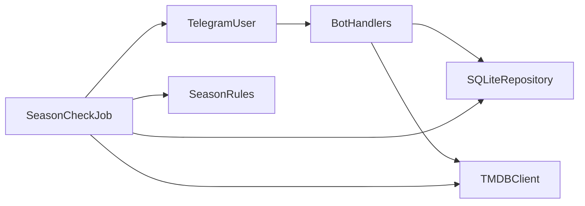

# TV Season Tracker MVP

## Ambiguities and decisions

The PRD leaves a few rules open, or states them in two ways. These choices keep the MVP small and match the constraints (Telegram only, TMDB as source of truth, no runtime LLM, no duplicate alerts, easy local tests).

- **No runtime LLM.** `/add` is a title search. TMDB relevance order plus a user pick is enough. An LLM would not be the source of truth and is not needed to detect seasons.
- **One confirmation UX.** Section 4 says “show the most likely match and ask yes/no.” Section 9 says “if several match, let the user pick.” MVP does both with one pattern: show up to 5 TMDB results as Telegram inline buttons (`Title (Year)`). One result is still a confirm/cancel. Zero results use the PRD not-found copy. No free-text “yes” parsing.
- **Already-released seasons are silent.** The PRD never says what happens the first time a show with past seasons is checked. Notifying every past season would spam the user on add. On confirm, store every numbered season whose TMDB `air_date` is already on or before today as seen, without sending a message. The daily job alerts only when a season later crosses that line.
- **“New season” means premiere date, not “fully available on a streamer.”** TMDB season `air_date` is the season premiere. Season number `0` and specials are ignored. Null or future `air_date` is ignored until a date exists and that calendar date is today or earlier. Streaming-service availability stays out of scope.
- **Any Telegram chat can track its own shows.** “Multiple users” in phase 2 is treated as accounts, sharing, and apps. Keying rows by `telegram_chat_id` is the same code as a personal bot. An optional `TELEGRAM_ALLOWED_CHAT_IDS` env var can lock the bot to specific chats.
- `**/remove` is by tracked title.** Case-insensitive unique match removes immediately. Several matches get the same inline picker. No match gets a short “not following that show” reply.
- **Dates use one timezone.** `CHECK_TIMEZONE` (default `UTC`) decides whether `air_date <= today`. The job runs once a day at `CHECK_HOUR` in that timezone (default 09:00).
- **Failed API or Telegram calls are retried next run.** A season is recorded as notified only after Telegram accepts the message. A TMDB failure for one show is logged and skipped; other shows still run. Empty tracking list exits before any TMDB call.

Known MVP limit: if TMDB later fills in an `air_date` for an old season that was null at add time, that season can notify once. That is acceptable.

## Architecture

One Python process. Long polling so local dev needs no public URL. The season check is a plain function with injected clock, TMDB client, repository, and notifier, so tests never touch Telegram or the network. APScheduler calls that function daily inside the process. The same function is runnable once via CLI.

Add flow: `/add Severance` → `GET /search/tv` → inline buttons → on pick, `GET /tv/{id}` → insert tracked show → insert baseline rows for released seasons.

Daily flow: if no tracked shows, stop. Else for each show, `GET /tv/{id}`, keep seasons with `season_number >= 1` and `air_date <= today`, skip season numbers already stored, send `🎬 New season available: {title} — Season {n}`, then insert the notified row.

## Tech stack

- **Python 3.12**, `src` layout, `pytest`
- **python-telegram-bot** (v21, long polling, inline keyboards)
- **httpx** for TMDB
- **stdlib sqlite3**, WAL mode, schema applied on startup from `schema.sql` (no migration framework)
- **APScheduler** for the daily trigger only; detection logic stays outside it
- **python-dotenv** for local env

SQLite is enough for one bot and makes repository tests use an in-memory or temp file database. Webhooks, Redis, Postgres, and a separate worker are unnecessary.

## Repository structure

- [docs/pdr.md](docs/pdr.md) — existing PRD
- `README.md` — env vars, create a Telegram bot, TMDB key, run locally, run the job once
- `pyproject.toml` — deps and pytest
- `.env.example` — `TELEGRAM_BOT_TOKEN`, `TMDB_API_KEY`, `CHECK_TIMEZONE`, `CHECK_HOUR`, `TELEGRAM_ALLOWED_CHAT_IDS`
- `src/tvtracker/config.py` — env loading
- `src/tvtracker/main.py` — start polling and scheduler
- `src/tvtracker/bot/handlers.py` — `/start`, `/help`, `/add`, `/list`, `/remove`, callback queries
- `src/tvtracker/bot/messages.py` — PRD copy in one place
- `src/tvtracker/tmdb/client.py` — search and TV details, map into small dataclasses
- `src/tvtracker/db/schema.sql` — tables below
- `src/tvtracker/db/repository.py` — users, tracked shows, seen seasons, pending picks
- `src/tvtracker/domain/seasons.py` — pure filter: which seasons are eligible and which are new
- `src/tvtracker/jobs/check_seasons.py` — orchestration plus `python -m tvtracker.jobs.check_seasons`
- `tests/` — domain, repository, job with fakes, handler tests with a fake TMDB client

## Database

- **users** — `id`, `telegram_chat_id` unique, `created_at`
- **tracked_shows** — `id`, `user_id`, `tmdb_id`, `title`, `first_air_year`, `added_at`; unique `(user_id, tmdb_id)`
- **seen_seasons** — `id`, `tracked_show_id`, `season_number`, `air_date`, `status` (`baseline` or `notified`), `notified_at` nullable; unique `(tracked_show_id, season_number)`
- **pending_choices** — `telegram_chat_id` primary key, `action` (`add` or `remove`), `payload_json`, `expires_at`. One active picker per chat. `/cancel` or a new `/add` or `/remove` replaces it. Expire after 15 minutes.

Show identity is `tmdb_id`, not the title. Titles are stored only for messages and `/list` / `/remove`.

Dedup rule: the job inserts nothing until `send_message` succeeds, then inserts `status=notified`. The unique key makes a second insert a no-op. Baseline rows are inserted in the same transaction as the tracked show, so the first daily run cannot treat history as new. Only one scheduler runs (in-process). Overlapping manual CLI runs are safe enough at this scale because the unique key blocks a second alert after the first insert; a send that succeeds and then fails to insert can repeat once the next day, which is the failure mode we accept rather than marking “sent” before Telegram confirms.

## Job logic (testable core)

`newly_released(seasons, today)` returns numbered seasons with a non-null `air_date <= today`.

`check_all(repo, tmdb, notifier, today)`:

- Load tracked shows. If empty, return without calling TMDB.
- For each show, fetch details. On error, log and continue.
- Drop seasons already present in `seen_seasons`.
- Send, then insert. On send error, log and leave the season unseen so the next run retries.

Tests pass a fixed `today`, a fake TMDB payload, and a fake notifier. Cases: empty list, season 0 ignored, null date ignored, future date ignored, baseline seasons not sent, first newly released season sent once, second call sends nothing, one show’s TMDB error does not block the next show.

## Milestones

1. **Scaffold and persistence.** Package, config, schema, repository, tests for add/list/remove and unique `(chat, tmdb_id)` plus unique `(show, season)`.
2. **TMDB client.** Search and details against recorded JSON fixtures. Map `id`, `name`, `first_air_date`, `seasons[].season_number`, `seasons[].air_date`.
3. **Season rules and job.** Pure filter plus `check_all` tests listed above. CLI entry that runs once against the real DB.
4. **Telegram commands.** `/start`, `/help`, `/list`, `/add` with inline confirm, `/remove` with unique-or-pick, `/cancel`, not-found and API-down copy, duplicate-add reply, optional chat allowlist.
5. **Daily schedule and local run docs.** APScheduler at `CHECK_HOUR`, structured logs on per-show failure, README with a manual one-shot command so the job can be tested without waiting a day.

